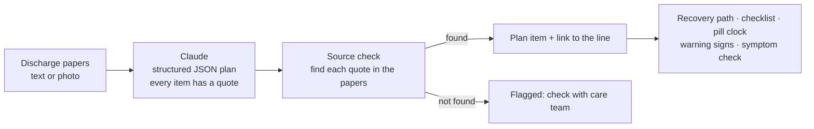

# 🚀 Liftoff

**Every recovery needs a launchpad.**

Liftoff turns hospital discharge papers into a day-by-day recovery plan a patient can follow at home. Claude reads the papers and builds the plan, then plain code checks that every item really appears in the original papers and links it to the exact line the care team wrote.

Built solo for **DSH Hacks V2** (AI x Healthcare).


- **Demo video:** [`demo/liftoff-demo.mp4`](demo/liftoff-demo.mp4) (1:53, 1080p)
- **Live demo:** https://claude.ai/artifact/RoZ9BRWdM69ZtuBqcP3e76 (runs on the viewer's own Claude account)
- **Devpost write-up:** [`docs/DEVPOST.md`](docs/DEVPOST.md)

## The problem

Patients leave the hospital with pages of dense instructions about medicines, wound care, activity limits and warning signs, right when they're tired, in pain and starting new medicines. Instructions get misread or forgotten, and warning signs get missed.

## What Liftoff does

| | |
|---|---|
| **Scan** | Paste the discharge text or upload a photo. Claude turns it into a structured plan: medicines, daily tasks, limits, milestones, warning signs and open questions. |
| **Source check** | Every plan item carries a quote from the papers. Code (not AI) finds that quote in the original text. Items that can't be found are flagged instead of trusted. |
| **Recovery path** | A "flight profile" from discharge to full activity, with the papers' milestones on it and a rocket at today. Tap any day to preview it. |
| **Today's checklist** | Doses and tasks grouped by morning, afternoon and evening. Counters for things like 8 glasses of water. A fuel bar fills as you go. |
| **Pill clock** | A 24-hour dial with one orbit per medicine, every dose on it, and a countdown to the next one. |
| **Your papers** | Tap **Source** on anything: the original papers slide in and a line traces the item to the highlighted sentence. |
| **When to get help** | 911 signs and call-your-doctor signs, straight from the papers, with the clinic numbers. |
| **Symptom check** | Describe how you feel. Liftoff compares it only with the warning signs in your papers and quotes the line it matched. It never diagnoses. |
| **Questions** | If the papers are unclear (e.g. "continue your home medications" with no list), Liftoff adds a question for the care team instead of guessing. |
| **Languages & read aloud** | Switch the plan to Spanish, Chinese, Vietnamese or Tagalog. The quotes stay in the original so the source check still holds. Read today's list aloud. |

| Scan | Source trace | Spanish |
|---|---|---|
|  |  |  |

## How it works



- **One schema, two AI paths.** `src/lib/schema.ts` defines the plan with Zod. The Node server uses it for Claude structured outputs (`server/index.ts`). The published claude.ai artifact sends the same prompt through the viewer's own Claude and validates the reply against the same schema (`src/lib/ai.ts`).
- **The source check is deterministic.** `src/lib/verify.ts` compares letters and digits only, so line breaks and punctuation don't hide a match, but changed words or numbers do.
- **Offline demo mode.** With no AI connection, the sample papers load a saved result with the same shape, and the symptom check falls back to keyword matching against the papers' warning signs.

## Run it

```bash
npm install

# Full app with AI (Claude via the Anthropic API)
export ANTHROPIC_API_KEY=sk-ant-...
npm run dev              # web on http://localhost:5173, API on :8787

# No API key? The sample papers still work end to end (saved result).
npm run dev:web
```

Other scripts:

| Command | What it does |
|---|---|
| `npm test` | Unit tests: source check, schedule, symptom matcher, translation, plan parsing |
| `npm run typecheck` | TypeScript check for app and server |
| `npm run build && npm start` | Production build served by the API server on :8787 |
| `npm run build:artifact` | Single-file build (`dist-artifact/liftoff.html`) for publishing as a claude.ai artifact |
| `npm run demo:record` | Records the demo video to `demo/liftoff-demo.mp4` (needs ffmpeg; run `npm run build` first) |

The included video uses the saved sample result. To record it with a live Claude result, start the server with an API key (`npm run build && npm start`) and run `npm run demo:record -- --url http://localhost:8787`.

Set `LIFTOFF_MODEL` to change the model (default `claude-opus-5-5`).

## Project layout

```
server/index.ts           API: /api/analyze, /api/symptom, /api/translate (Anthropic SDK)
src/lib/schema.ts         Plan schema (Zod), shared by server and client
src/lib/prompts.ts        Prompts, shared by server and artifact
src/lib/verify.ts         Source check: find each quote in the papers
src/lib/ai.ts             Picks artifact runtime, server, or offline mode
src/lib/schedule.ts       Turns the plan into a day's checklist, doses, countdowns
src/components/           Landing, scan, flight profile, checklist, pill clock, papers panel…
src/data/sample.ts        Fictional sample papers + saved result
scripts/record-demo.mjs   Scripted demo recording (Playwright + ffmpeg)
```

## Tech

React 19, TypeScript, Vite, Express, Zod, Anthropic SDK (Claude structured outputs), Playwright + ffmpeg for the demo video. Fonts: Saira Condensed, IBM Plex Sans, IBM Plex Mono.

## Safety

Liftoff only reorganizes what the care team wrote. It doesn't add medical advice, and the symptom check only compares against the papers' own warning signs. The sample patient, hospital and phone numbers are fictional. This is a hackathon prototype, not a medical device. Always follow your care team's instructions.

---

Built by [@Shyboy0499](https://github.com/Shyboy0499) at DSH Hacks V2.
