<h1 align="center"> Liftoff</h1>

<p align="center"><b>Every recovery needs a launchpad.</b></p>

<p align="center">
Liftoff turns hospital discharge papers into a day-by-day recovery plan a patient can follow at home.<br>
Claude reads the papers (typed or photographed). Then plain code checks that every item in the plan really appears in them,<br>
and links it to the exact line the care team wrote.
</p>

<p align="center">
  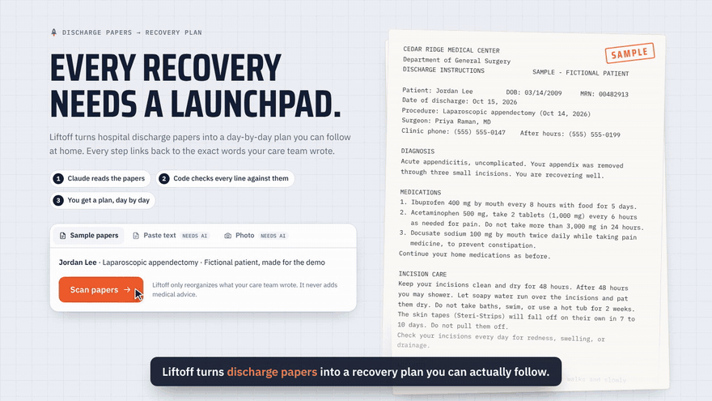
</p>

<p align="center">
  <a href="demo/liftoff-demo.mp4"><b>▶ Full demo video (1:53)</b></a> ·
  <a href="https://claude.ai/artifact/RoZ9BRWdM69ZtuBqcP3e76"><b>Live demo</b></a> ·
  <a href="docs/DEVPOST.md"><b>Devpost write-up</b></a>
</p>

<p align="center">Built solo for <b>DSH Hacks V2</b> · AI x Healthcare</p>

---

## The problem

Patients leave the hospital with pages of dense instructions about medicines, wound care, activity limits and warning signs, right when they're tired, in pain and starting new medicines. Instructions get misread or forgotten, and warning signs get missed.

## What Liftoff does

### 1. Scan the papers: type, paste, or take a photo

Paste the discharge text or upload a photo. Claude reads it (photos too, with Claude's vision) and turns it into a structured plan: medicines, daily tasks, limits, milestones, warning signs and open questions.

| Choose a photo | Claude reads it |
|---|---|
| 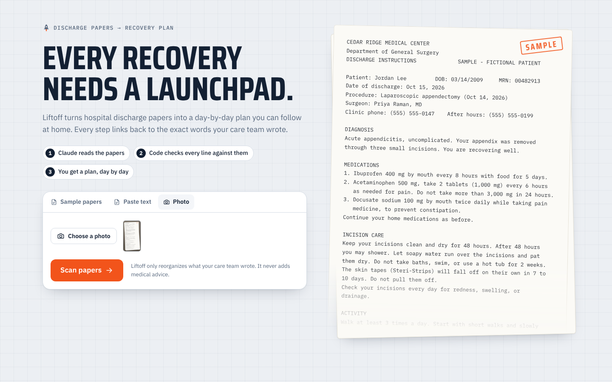 | 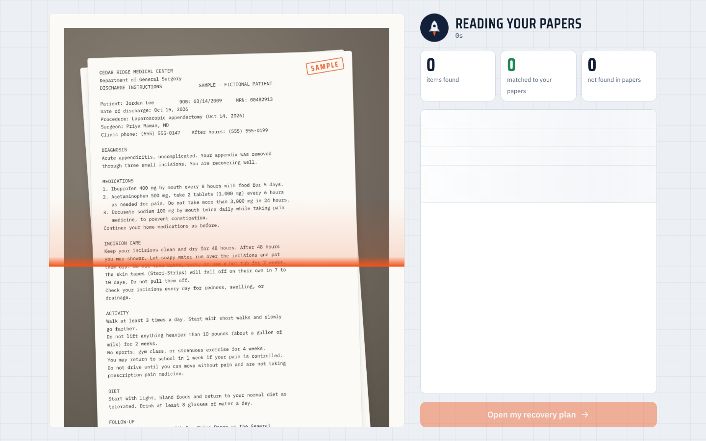 |

### 2. Check every item against the papers

Every plan item carries an exact quote from the papers. Code (not AI) finds that quote in the original text. Items it can't find are flagged instead of trusted.

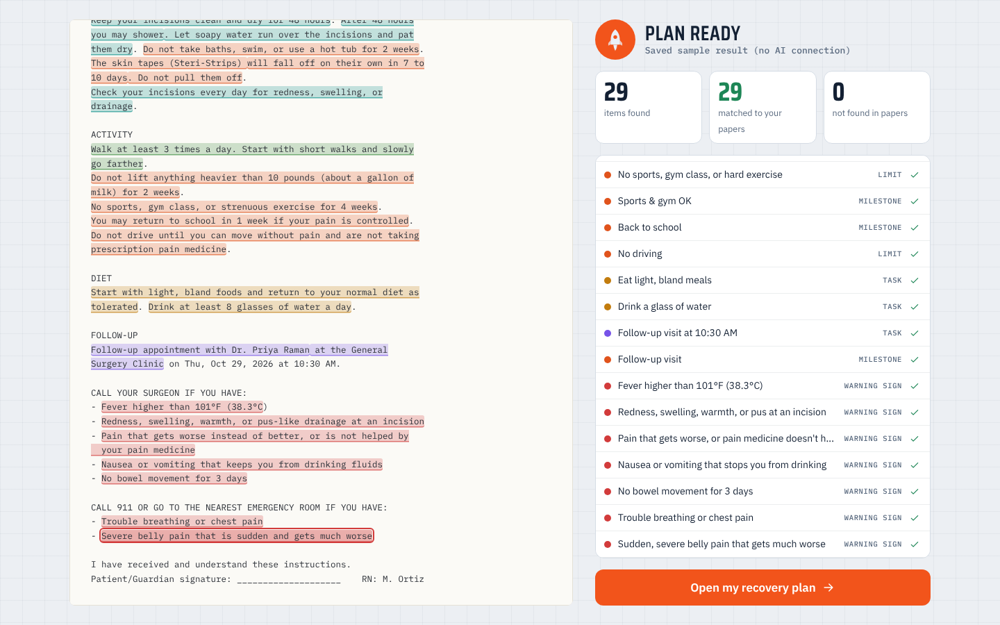

### 3. Follow the plan, day by day

A "flight profile" runs from discharge to full activity, with the papers' milestones on it and a rocket at today. Below it are today's checklist (with a fuel bar that fills as you go), a 24-hour pill clock with every dose, the warning signs and countdowns for things you can't do yet.

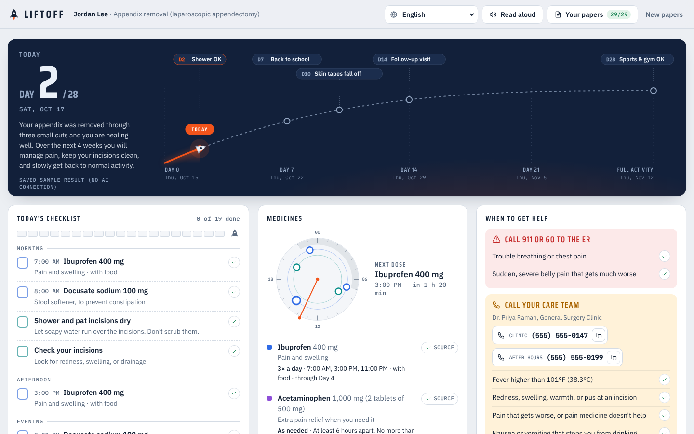

### 4. See where anything came from

Tap **Source** on any item. The original papers slide in and a line traces the item to the highlighted sentence.

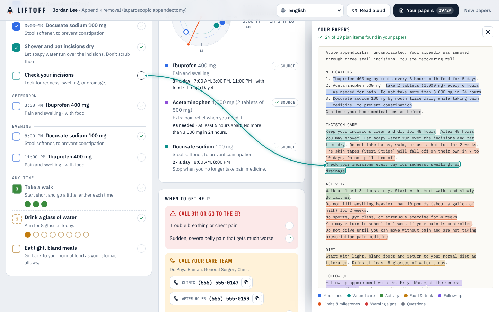

### 5. Check a symptom against your own papers

Describe how you feel. Liftoff compares it only with the warning signs in your papers, quotes the line it matched and shows who to call. It never diagnoses.

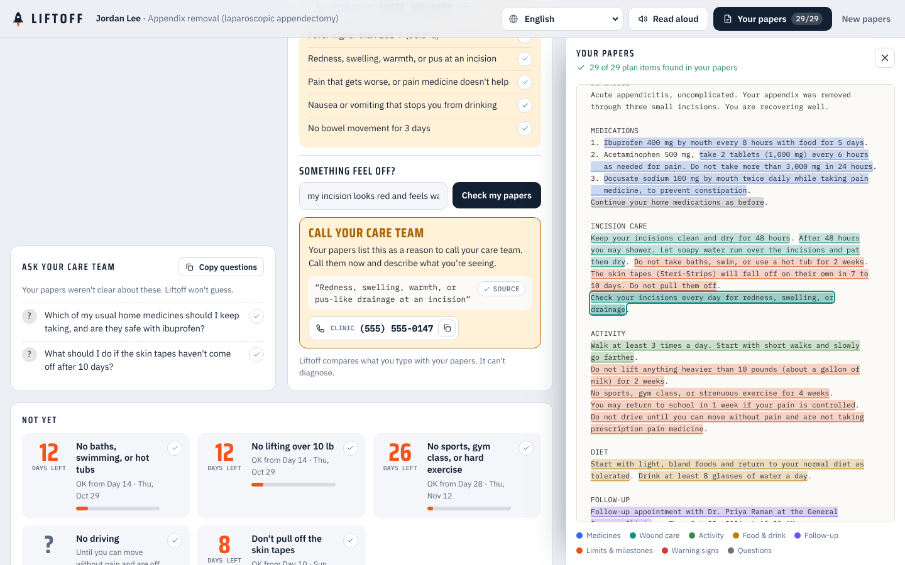

### 6. In your language, light or dark, on any screen

Switch the plan to Spanish, Chinese, Vietnamese or Tagalog. The quotes stay in the original so the source check still holds. Today's list can also be read aloud.

| Spanish | Dark mode | Phone |
|---|---|---|
| 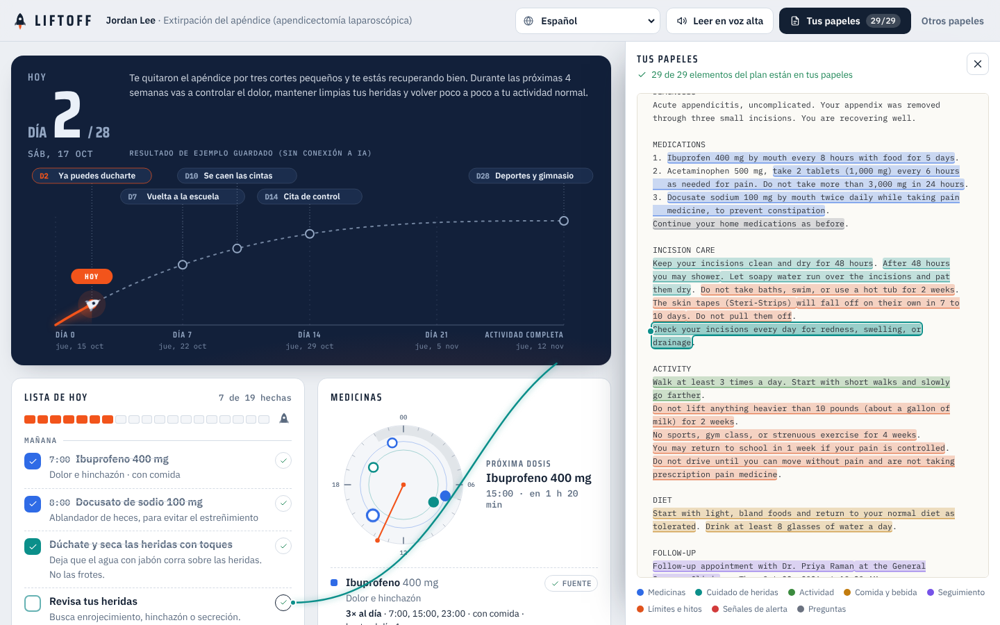 | 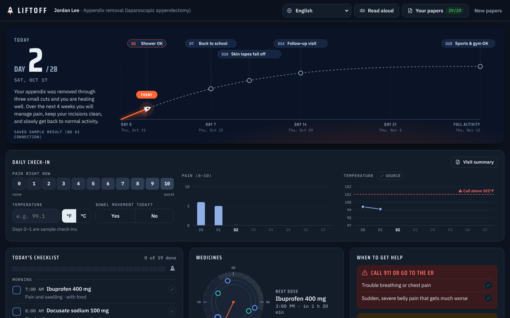 | 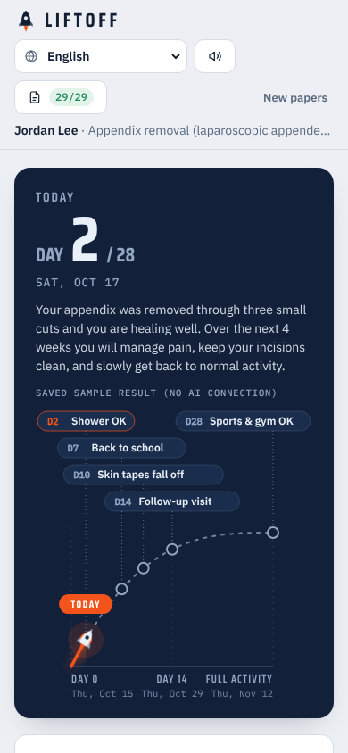 |

## How it works

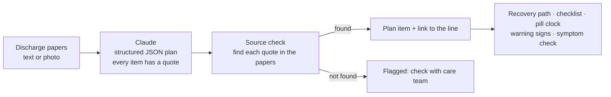

- **One schema, two AI paths.** `src/lib/schema.ts` defines the plan with Zod. The Node server uses it for Claude structured outputs (`server/index.ts`). The live claude.ai demo sends the same prompt through the viewer's own Claude and checks the reply against the same schema (`src/lib/ai.ts`).
- **Photos.** The browser shrinks a photo to at most 2576 px on the long edge (the most Claude reads) and sends it to Claude, which writes out the text it sees. The source check then runs against that text.
- **The source check is deterministic.** `src/lib/verify.ts` compares letters and digits only, so line breaks and punctuation don't hide a match, but changed words or numbers do.

## Set up your API key

Liftoff runs without a key, but then only the built-in sample papers work (using a saved result). To scan **your own** papers, typed or photographed, Liftoff needs a Claude API key. One key covers everything: reading text, reading photos (vision), the symptom check and translation. There is no separate "vision" key.

1. Create a key at **[console.anthropic.com](https://console.anthropic.com/)** → *API Keys* → *Create Key*. You'll need to add a little credit under *Billing*.
2. Copy the example settings file and paste your key into it:
   ```bash
   cp .env.example .env
   # then open .env and set:
   # ANTHROPIC_API_KEY=sk-ant-...
   ```
3. Start Liftoff (below). The server reads `.env` on start and prints `AI on` when the key is found.

`.env` is in `.gitignore`, so your key never gets committed. Don't paste it anywhere public.

**Cost:** you pay Anthropic per request. One scan is roughly a few cents to about 10 cents with the default model (Claude Opus 5.5). Set `LIFTOFF_MODEL` in `.env` to use a different Claude model.

**Try photo scanning:** use [`docs/sample-papers.jpg`](docs/sample-papers.jpg), a photo-style image of the sample papers, in the **Photo** tab.

## Run it

```bash
npm install
npm run dev        # web on http://localhost:5173, API on :8787
```

With no `.env`, the app still runs: the sample papers work end to end, and the Paste and Photo tabs show that they need an AI connection.

| Command | What it does |
|---|---|
| `npm test` | Unit tests: source check, schedule, symptom matcher, translation, plan parsing |
| `npm run typecheck` | TypeScript check for app and server |
| `npm run build && npm start` | Production build served by the API server on :8787 |
| `npm run build:artifact` | Single-file build (`dist-artifact/liftoff.html`) for publishing as a claude.ai artifact |
| `npm run demo:record` | Records the demo video to `demo/liftoff-demo.mp4` (needs ffmpeg; run `npm run build` first) |

The included video uses the saved sample result. To record it with a live Claude result, set up your key, run `npm run build && npm start`, then `npm run demo:record -- --url http://localhost:8787`.

## Project layout

```
server/index.ts           API: /api/analyze, /api/symptom, /api/translate (Anthropic SDK)
src/lib/schema.ts         Plan schema (Zod), shared by server and client
src/lib/prompts.ts        Prompts, shared by server and artifact
src/lib/verify.ts         Source check: find each quote in the papers
src/lib/ai.ts             Picks artifact runtime, server, or offline mode; shrinks photos
src/lib/schedule.ts       Turns the plan into a day's checklist, doses, countdowns
src/components/           Landing, scan, flight profile, checklist, pill clock, papers panel…
src/data/sample.ts        Fictional sample papers + saved result
scripts/record-demo.mjs   Scripted demo recording (Playwright + ffmpeg)
```

## Tech

React 19 · TypeScript · Vite · Express · Zod · Anthropic SDK (Claude structured outputs and vision) · Playwright + ffmpeg for the demo video. Fonts: Saira Condensed, IBM Plex Sans, IBM Plex Mono.

## Safety

Liftoff only reorganizes what the care team wrote. It doesn't add medical advice, and the symptom check only compares against the papers' own warning signs. The sample patient, hospital and phone numbers are fictional. This is a hackathon prototype, not a medical device. Always follow your care team's instructions.

---

<p align="center">Built by <a href="https://github.com/Shyboy0499">@Shyboy0499</a> at DSH Hacks V2</p>
